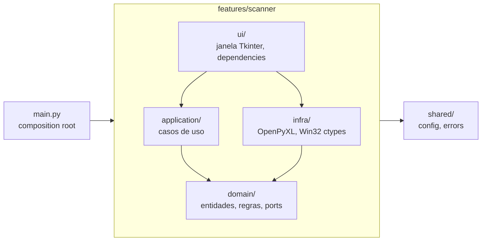

# Arquitetura

## Visão geral

**Feature-based (vertical slices) com camadas internas**, adaptada do template padrão Python para
uma aplicação **Desktop GUI & Automação de Sistema** (sem FastAPI/SQLAlchemy). Ver `adr/0001` e `adr/0002`.

## Camadas

| Camada | Contém | Pode importar | Nunca |
|---|---|---|---|
| `domain/` | `@dataclass(frozen=True)` entidades, regras puras, `Protocol` (ports) | `app.shared.errors`, stdlib | `tkinter`, `openpyxl`, `ctypes`, I/O |
| `application/` | Casos de uso (1 por arquivo), classe com deps no `__init__` e `__call__` | `domain/`, `shared` | `infra/`, `ui/`, `tkinter`, `openpyxl`, `ctypes` |
| `infra/` | Repositórios `openpyxl`, gateways Win32 (`ctypes`), fakes em memória | `domain/`, `shared`, libs | `ui/`, `application/`, `tkinter` |
| `ui/` | `scanner_window.py` (Tkinter), `dependencies.py` (monta casos de uso) | todas as camadas da feature, `shared` | Regra de negócio pura |
| `__init__.py` | API pública da feature (`run_scanner_app`, `AnjunAutoScannerApp`) | a própria feature | — |

`main.py` é o **composition root**: carrega `Settings`, configura `logging` e inicia a janela principal.

## Regras de dependência (impostas pelo import-linter)

Configuração em `[tool.importlinter]` do `pyproject.toml`:

1. **Camadas**: `ui` > `application | infra` > `domain`.
2. **Domínio puro**: `domain` não importa `tkinter`, `openpyxl`, `ctypes`.
3. **shared** nunca importa `app.features`.
